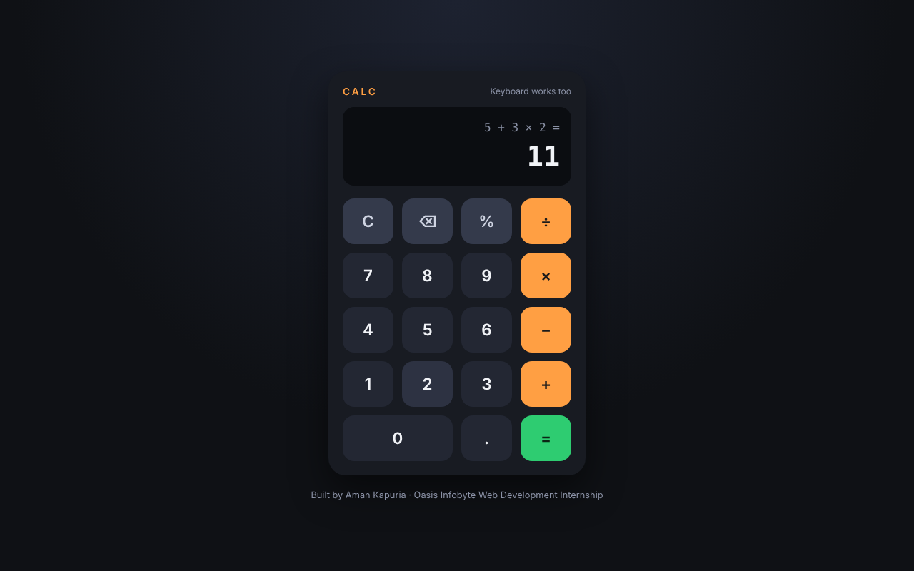
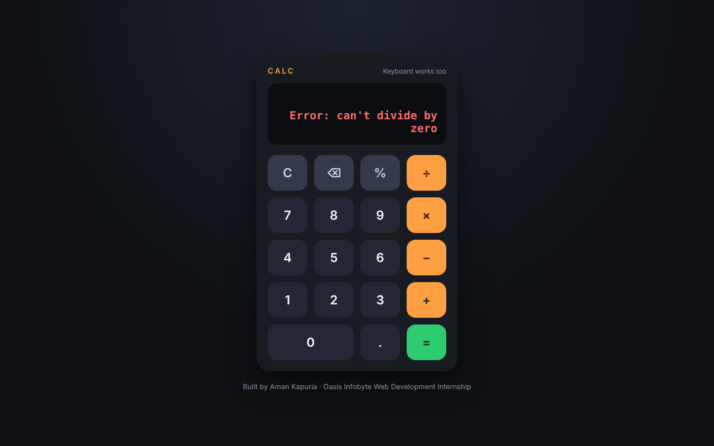
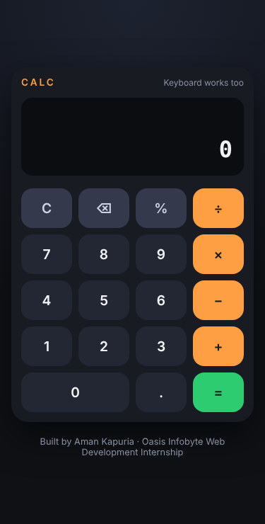

# Calculator — Oasis Infobyte Internship

**Track:** Web Development & Designing · **Level 2 · Task 1**
**Intern:** Aman Kapuria

A browser-based calculator built with plain HTML, CSS and JavaScript. It does the four basic operations, follows the correct order of operations, and never uses `eval()`.

## Features (task checklist)

- [x] Display screen showing the current input and the result
- [x] Number buttons (0–9) and a decimal point button
- [x] Operator buttons: +, −, ×, ÷
- [x] Equals (=) button
- [x] Clear (C) button
- [x] Backspace (⌫) button
- [x] Division by zero shows an error message instead of crashing
- [x] Operator chaining — e.g. `5 + 3 × 2` gives `11`, and you can keep going after `=`
- [x] Button layout made with **CSS Grid**
- [x] All buttons use `addEventListener` — no inline `onclick` in the HTML

**Extras:** keyboard support, percent button, live running answer while typing, fixes floating-point results (0.1 + 0.2 = 0.3), responsive on phones.

## How it works

Everything typed is stored in an array, for example `["5", "+", "3", "×", "2"]`.
When `=` is pressed, the expression is solved in two passes:
1. First all `×` and `÷` (left to right)
2. Then all `+` and `−` (left to right)

This gives the correct maths answer without `eval()`.

## Tech stack

HTML5, CSS3 (Grid), Vanilla JavaScript

## Run it

Download the folder and open `index.html` in any browser. No install needed.

## Screenshots

| Typing | Result | Divide by zero | Mobile |
|---|---|---|---|
|  |  |  |  |
