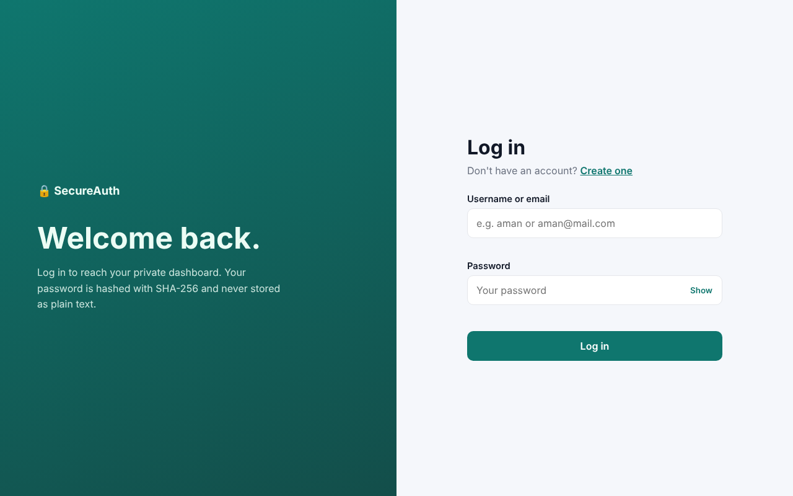
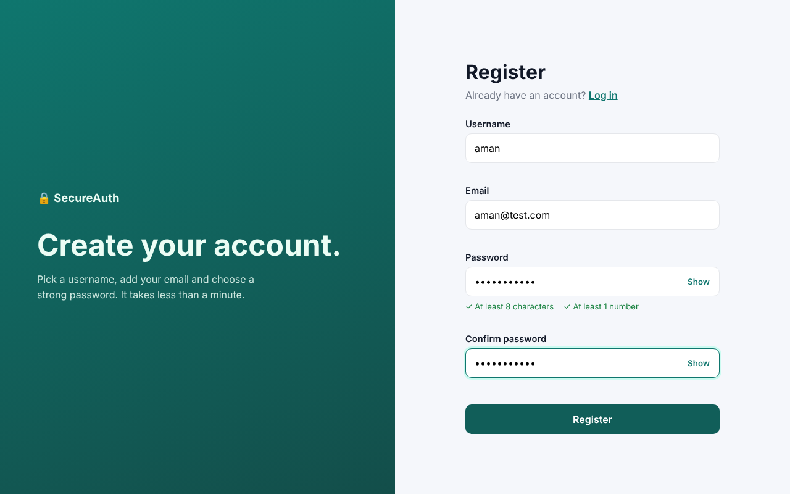
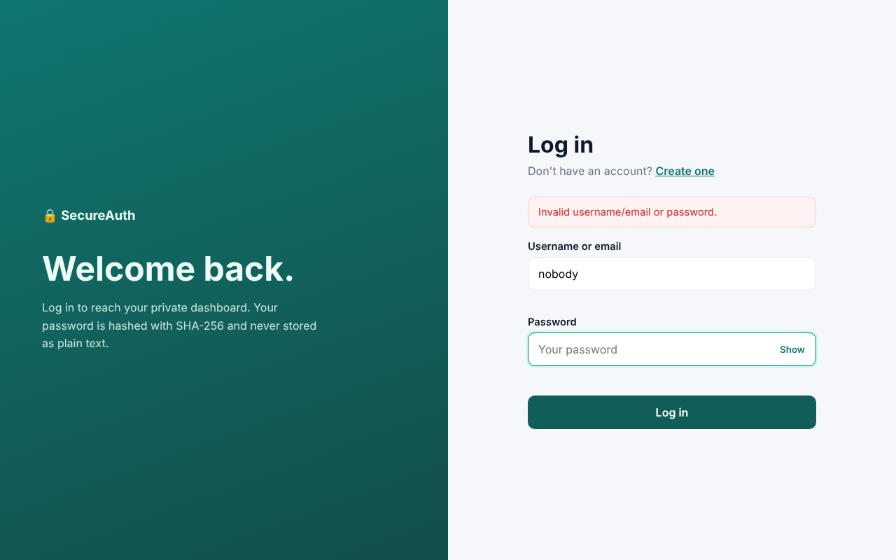
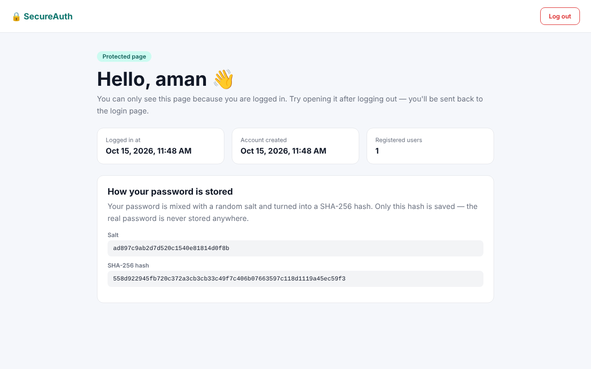
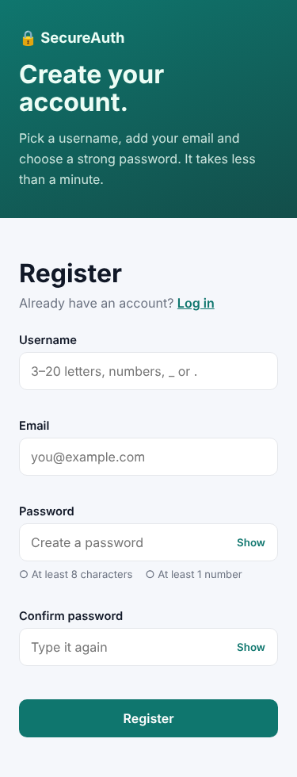

# Login Authentication System — Oasis Infobyte Internship

**Track:** Web Development & Designing · **Level 2 · Task 4**
**Intern:** Aman Kapuria

A login system with registration, login, a protected dashboard and logout. Built with **approach (A)** from the task: front-end only, using HTML, CSS, JavaScript and `localStorage`.

## Features (task checklist)

- [x] Registration page with username, email and password + "Register" button
- [x] Password rules: at least 8 characters and at least 1 number (shown live while typing)
- [x] Duplicate check — error if the username or email already exists
- [x] Login page with username/email and password + "Login" button
- [x] Wrong login shows one clear message that does **not** reveal which field was wrong
- [x] Protected dashboard — opening it without logging in sends you back to the login page
- [x] Logout button clears the session and goes back to login
- [x] Passwords are **not** stored as plain text — they are salted and hashed with **SHA-256**
- [x] Form validation on both pages — no empty submissions

**Extras:** confirm-password field, show/hide password, username and email format checks, "account created" message, dashboard shows the stored salt and hash to prove the password isn't saved.

## How passwords are stored

1. When you register, a random 16-byte **salt** is created.
2. The salt and password are joined and hashed with **SHA-256** using the browser's built-in Web Crypto API (`crypto.subtle.digest`).
3. Only the username, email, salt and hash are saved. The real password is never saved.
4. When you log in, the same steps run on the password you typed, and the two hashes are compared.

## Pages

| File | What it does |
|---|---|
| `index.html` | Login page |
| `register.html` | Registration page |
| `dashboard.html` | Protected page (only after login) |
| `auth.js` | Shared code: hashing, register, login, session, logout |
| `style.css` | Styles for all pages |

## A note on security

This is a front-end learning project. Since all data lives in the browser's `localStorage`, it is not meant for real users. A real app would keep users on a server and use a slow hashing method like bcrypt.

## Tech stack

HTML5, CSS3, Vanilla JavaScript, Web Crypto API (SHA-256), localStorage

## Run it

Open `index.html` in a browser (Chrome, Edge or Firefox). The hashing needs a secure page, so if it shows an error, open it through **GitHub Pages** or a local server (for example the VS Code "Live Server" extension).

## Screenshots

| Login | Register | Wrong login | Dashboard | Mobile |
|---|---|---|---|---|
|  |  |  |  |  |
