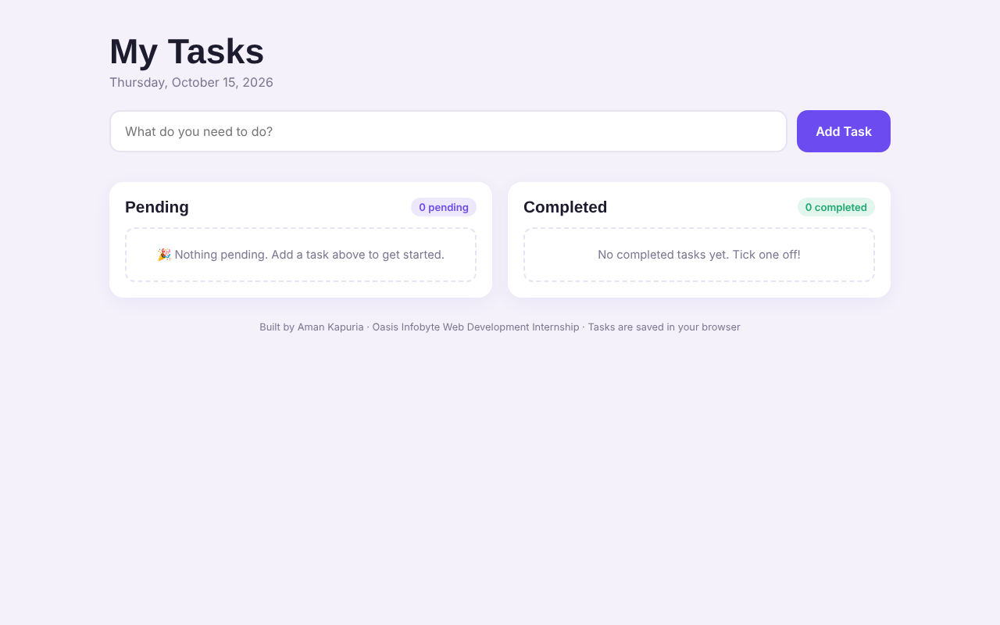
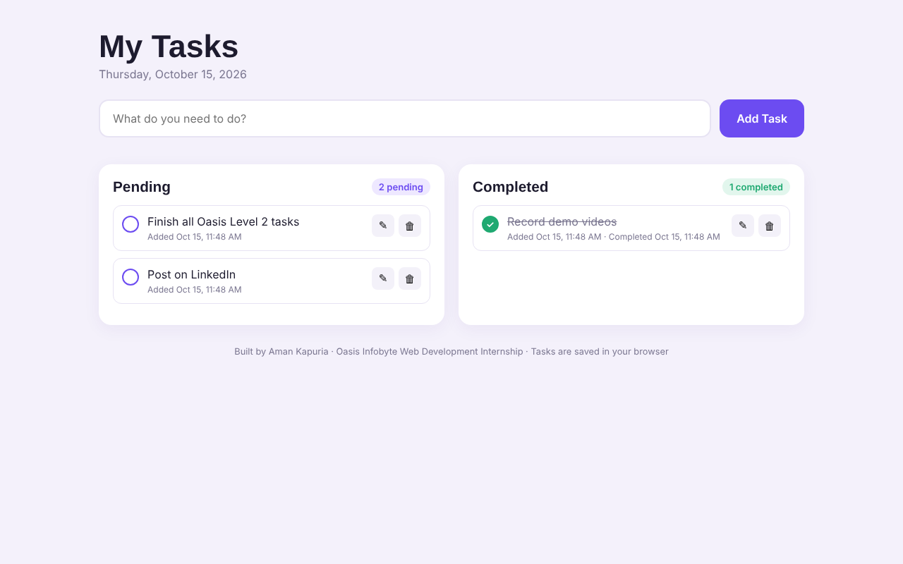
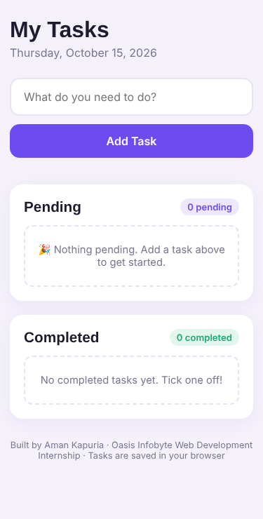

# To-Do Web App — Oasis Infobyte Internship

**Track:** Web Development & Designing · **Level 2 · Task 3**
**Intern:** Aman Kapuria

A to-do list app where you can add, complete, edit and delete tasks. Tasks are split into **Pending** and **Completed** lists and are saved in the browser, so they stay after a refresh.

## Features (task checklist)

- [x] Input field + "Add Task" button
- [x] New tasks appear straight away in the Pending list
- [x] "Mark Complete" toggle moves a task to Completed (and back)
- [x] Edit button lets you change the task text inline (Enter to save, Esc to cancel)
- [x] Delete button removes a task from either list
- [x] Counters: "X pending" and "Y completed"
- [x] **Bonus:** timestamps showing when each task was added and completed
- [x] **Bonus:** tasks are saved with `localStorage` and survive page refreshes
- [x] Friendly message when a list is empty

**Extras:** blocks empty tasks with a message, double-click a task to edit, responsive layout.

## How it works

Each task is an object: `{ id, text, completed, createdAt, completedAt }`.
All tasks are kept in one array. After every change the array is saved to `localStorage`, and both lists are drawn again from it.

## Tech stack

HTML5, CSS3, Vanilla JavaScript, localStorage

## Run it

Open `index.html` in any browser.

## Screenshots

| Empty state | With tasks | Mobile |
|---|---|---|
|  |  |  |
