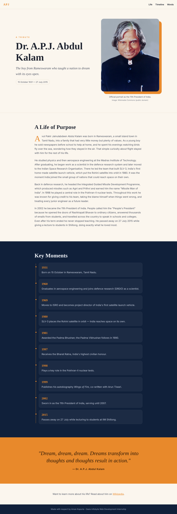
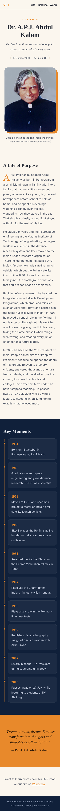

# Tribute Page: Dr. A.P.J. Abdul Kalam — Oasis Infobyte Internship

**Track:** Web Development & Designing · **Level 2 · Task 2**
**Intern:** Aman Kapuria

A tribute page to Dr. A.P.J. Abdul Kalam — scientist, "Missile Man of India" and the 11th President of India. All the written content is original and was put together from public sources such as Wikipedia.

## Features (task checklist)

- [x] Page title with his name and a one-line tagline
- [x] A large, prominent portrait (royalty-free image from Wikimedia Commons)
- [x] Biography / tribute section with 4 paragraphs of original writing
- [x] Timeline of key moments, shown as an ordered list of styled cards
- [x] A quote block styled differently from the rest of the page
- [x] 3 different background colours across sections (cream, navy, saffron)
- [x] 2 font styles: serif headings (Playfair Display) + sans-serif body (Source Sans 3)
- [x] Responsive layout for desktop and mobile

**Extras:** sticky navigation with smooth scrolling, drop-cap on the first paragraph, link to read more.

## Tech stack

HTML5, CSS3 (Grid, Flexbox, media queries), Google Fonts

## Run it

Open `index.html` in any browser.

## Image credit

Portrait of Dr. A.P.J. Abdul Kalam from [Wikimedia Commons](https://commons.wikimedia.org/) (public domain). Saved in `images/kalam.jpg`.

## Sources used for research

- [Wikipedia — A. P. J. Abdul Kalam](https://en.wikipedia.org/wiki/A._P._J._Abdul_Kalam)

## Screenshots

| Desktop | Mobile |
|---|---|
|  |  |
